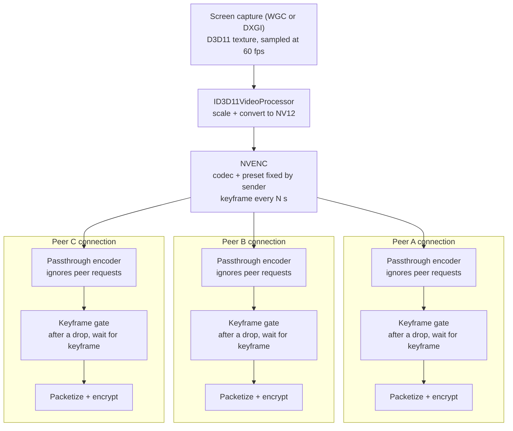

# High-resolution screen sharing for Voice on Windows

## Goal

Share a 7680×2160 240 Hz Windows desktop as 3840×1080 at 60 fps to every peer
in a mesh call, encoded once by NVENC. Frames stay on the GPU from capture to
encoder. The reference sender is an RTX 5090 with 300 Mbps of upload.

The audience is friends sharing gameplay. Simple, reliable code matters more
than smooth playback for every peer, so the design makes deliberate
concessions:

| Topic | Decision |
| --- | --- |
| Scope | Screen share on Windows with an NVIDIA GPU. Camera and every other platform keep today's path. |
| Encoder | One NVENC session per screen share, shared by every peer |
| Codec | H.264 first; AV1 and H.265 added afterwards as sender choices |
| Bitrate, resolution, frame rate | Fixed by a sender preset (e.g. 1080p60, half of the source at 60 fps); peers never lower it |
| Keyframes | Fixed interval chosen by the sender; keyframe requests from peers are ignored |
| Slow or late peers | Freeze or wait until the next keyframe (up to ~5 s is acceptable) |
| Peer that can't decode the codec | Gets no video, with a message saying why |
| Per-peer adaptation | None: no temporal layers, no per-peer thinning, no pausing |
| Self-preview | Off while sharing through the shared encoder; a "You're sharing" placeholder instead |
| No NVENC | Screen share uses today's software path |
| Sender upload too small | The user's responsibility; the picker shows how much upload the preset needs |

## Where we stand

The goal needs our own libwebrtc build. None of this is a Dart-only change.

| Area | Today | Where |
| --- | --- | --- |
| Windows app | No top-level `windows/` runner and no Windows CI job. The vendored `flutter_webrtc` already has Windows plugin code. | repository root, `.github/workflows` |
| libwebrtc | Prebuilt `libwebrtc.m150.7871.03` from webrtc-sdk. The Linux copy has software encoders only: VP8, OpenH264, AV1 (libaom), VP9. | `packages/discourse_voice/third_party/flutter_webrtc/third_party/libwebrtc_version.ini` |
| Decoders (desktop) | ffmpeg H.264, libvpx, dav1d AV1, all in software. No H.265 decoder: the Linux binary has only the H.265 parser. | same prebuilt binary |
| Decoders (Apple) | webrtc-sdk's VideoToolbox decoders for H.264 and H.265 in hardware; dav1d for AV1 | Darwin `flutter_webrtc` |
| Encoder hooks | The C++ wrapper can't take a custom encoder factory. Its only encoded-frame hook is the frame cryptor. | `third_party/libwebrtc/include/rtc_peerconnection_factory.h` |
| Screen capture | Captured frames are copied to the CPU and converted there (BGRA to I420). At 7680×2160 and 60 fps that is about 4 GB/s. | webrtc-sdk desktop capturer |
| Mesh sending | One connection and one video sender per peer, so N peers means N encodes. Camera and screen share use the same video sender. Video has no codec preference or bitrate limit. | `MeshVoiceMediaSession._createPeerNow` in `lib/src/plugins/voice/voice_media.dart` |

Flutter itself offers nothing here: it has no codec API, and WebRTC video is
encoded and decoded inside libwebrtc.

## Reference clients

[Litecord](https://github.com/Ak4ai/Litecord) (MIT) already does what we need:
DXGI or WGC capture, an `ID3D11VideoProcessor` pass that scales and converts
to NV12, NVENC fed directly with D3D11 textures, and one encoded frame sent to
every viewer. Read `encoder/nvenc_d3d11.rs`, `gpu_tx.rs` and `manager.rs`.
Avoid its bundled FFmpeg DLLs (no licence notice).

[Serein](https://github.com/ViceVerse-cz/Serein) encodes once only because it
sends a single stream to Discord's server, and its Windows encoder reads
frames back to the CPU. Nothing to take from it for this goal.

[LiveKit's Rust SDK](https://github.com/livekit/rust-sdks/tree/main/webrtc-sys/src)
has the libwebrtc-side prior art: `passthrough_video_encoder.cpp` and
`encoded_video_frame_buffer.cpp` feed already-encoded frames into every peer
connection.

## Constraints

- **Upload.** In mesh the sender uploads one copy per peer. Typical rates for
  fast-moving gameplay at 3840×1080, 60 fps (estimates, not measurements):

  | Codec | Bitrate | Upload to 3 peers | Upload to 6 peers |
  | --- | --- | --- | --- |
  | H.264 | ~25 Mbps | ~75 Mbps | ~150 Mbps |
  | H.265 | ~15 Mbps | ~45 Mbps | ~90 Mbps |
  | AV1 | ~12 Mbps | ~36 Mbps | ~72 Mbps |

  300 Mbps covers every row; peers' download is the real limit.
- **Codec level.** 3840×1080 at 60 fps needs H.264 High profile at level 5.1
  or 5.2 (`profile-level-id` `640033` or `640034`); the default negotiated
  profile stops around 720p. H.265 and AV1 need the matching level too.
- **Who can watch.**

  | Codec | Who can watch |
  | --- | --- |
  | H.264 | Everyone, including browsers |
  | AV1 | Every peer running our app (dav1d); most browsers. Older iPhones decode in software. |
  | H.265 | Apple peers in hardware; Windows and Linux peers once our build adds ffmpeg's HEVC decoder; not Firefox |

- **Licensing.** Write our own NVENC wrapper against the MIT-licensed
  `nvEncodeAPI.h` or FFmpeg's `nv-codec-headers`, and load
  `nvEncodeAPI64.dll` at runtime. NVIDIA's `NvEncoder*.cpp` samples are under
  NVIDIA's EULA; don't copy them. H.264 and H.265 royalties need counsel
  review.

## Phase 0 — Windows build

Done when a mesh call with screen share works on Windows with today's software
encoding, and we have CPU and frame-rate numbers at 1080p and at the
7680×2160 source as a baseline.

- [ ] Add the Windows Flutter runner and build Voice with the stock libwebrtc.
- [ ] Add a Windows CI job (format, analyze, build).
- [ ] Cover the Windows plugin files in `tool/vendor_provenance_contract.dart`.
- [ ] Record the baseline.

## Phase 1 — Our own libwebrtc build

Done when the app runs on our build with no change in behaviour.

- [ ] Fork `webrtc-sdk/libwebrtc` on `m150_release`.
- [ ] Build `libwebrtc.dll` (x64) in CI and point `libwebrtc_version.ini` at
  our release.
- [ ] Document the fork in `PATCHES.md` and extend the provenance check.

## Phase 2 — Shared NVENC screen share (H.264)

This phase reaches the goal. Done when:

- a 7680×2160 240 Hz source is sent as 3840×1080 at 60 fps H.264 to 3 peers,
  using one NVENC session and no CPU frame copies on the sender;
- a peer that drops frames freezes and recovers at the next keyframe without
  affecting the others;
- a sender without NVENC still shares through today's path.

Nothing a peer does reaches the encoder or the other peers.

### Parts (C++ in our libwebrtc fork)

1. **GPU capture and scaling.** Capture with WGC or DXGI at the preset's
   frame rate, not the display's 240 Hz. Scale and convert to NV12 in one
   `ID3D11VideoProcessor` pass; NVENC doesn't scale its input. Halving
   7680×2160 to 3840×1080 keeps the 32:9 aspect ratio. No frame is ever read
   back to the CPU, which is why the self-preview goes away.
2. **Shared NVENC encoder.** Owns the session and takes D3D11 textures
   directly. Its settings come only from the sender: codec, resolution, frame
   rate, CBR bitrate, no B-frames, low-latency tuning and a fixed keyframe
   interval. It emits encoded frames into one track source.
3. **Passthrough encoder per peer**, modelled on LiveKit's. Forwards the
   shared encoded frames with the codec-specific information libwebrtc needs
   to packetize. Ignores requested rate changes and keyframe requests, and
   reports no scaling and trusted rate control so libwebrtc doesn't resize
   anything.
4. **Per-peer keyframe gate.** The only per-peer logic, and it can't be
   skipped. If libwebrtc drops a frame for one peer, that peer gets nothing
   until the next keyframe. Otherwise its next frame would point at the wrong
   reference and decode corrupted instead of freezing.
5. **A way to start a shared-encode screen share** from `flutter_webrtc`,
   plus an "is NVENC available" check.

### Required libwebrtc settings

The passthrough sends at the preset's fixed bitrate. If that exceeds what
libwebrtc allows for a peer, libwebrtc drops frames for that peer, and the
keyframe gate turns each drop into a freeze until the next keyframe. These
settings are part of the design, not tuning:

- Set the sender's maximum bitrate (`encodings[].maxBitrate`) to the preset's
  rate. Without it libwebrtc caps video at roughly 2.5 Mbps.
- Raise the bandwidth estimate's start and minimum bitrates to the preset's
  rate. The estimate otherwise starts at a few hundred kbps, and the peer
  freezes repeatedly while it climbs.
- Negotiate H.264 High profile at level 5.1 or 5.2.

### Dart side (`MeshVoiceMediaSession`)

- When NVENC is available, start screen share through the shared encoder;
  otherwise keep today's path.
- Prefer H.264 on the screen-share sender and apply the settings above.
- Replace the self-preview with a "You're sharing" placeholder.
- Add a preset picker that shows the upload it needs ("needs ~X Mbps upload
  with N viewers").
- Lay out 32:9 video tiles without shrinking them into a letterbox.

### Tests

- C++ unit tests for the gate (drop, gate, resume on keyframe) and the
  passthrough (rate and keyframe requests ignored).
- Dart tests in the style of the existing Voice session tests, pinning the
  bitrate, codec and level settings and the fallback when NVENC is missing.

## Phase 3 — AV1 and H.265

Add the sender's codec choice once H.264 works end to end.

- [ ] AV1 through NVENC. The passthrough must also produce the
  frame-dependency header AV1 packets carry; LiveKit has done this.
- [ ] H.265 through NVENC, plus ffmpeg's HEVC decoder in our Windows and
  Linux builds so desktop peers can watch it.
- [ ] Codec picker in the sender's preset UI; a peer that can't decode the
  chosen codec gets no video and a message saying why.

## Phase 4 — Receivers, if measurements demand it

Measure receivers at 3840×1080, 60 fps before building anything here.

- **Decoding.** A 3840×1080 60 fps H.264 stream is heavy for ffmpeg's
  software decoder; dav1d copes better with AV1. If software decoding can't
  keep up, add hardware decoders in the same fork.
- **Drawing.** `flutter_webrtc` converts each decoded frame to RGBA on the CPU
  and copies it into a Flutter texture, about 1 GB/s at this size. If that
  costs too much, pair hardware decoding with a GPU texture path into Flutter.

## Not planned

These are deliberately out of scope until the goal works:

- Media Foundation, AMD AMF and Intel QSV encoders for non-NVIDIA senders
- Hardware encoding for the camera
- Linux and macOS senders
- A software fallback inside the shared encoder (non-NVENC senders use
  today's path instead)

## Open questions

- [ ] Is Windows a committed target? Phase 0 also means installer, signing and
  update work.
- [ ] Are we OK owning a libwebrtc build on every upstream bump?
- [ ] Which presets and keyframe interval ship by default (e.g. 1080p60 and
  half of the source, 2–5 s)?
- [ ] With Windows HDR on, captured frames need converting to SDR. Can the
  same `ID3D11VideoProcessor` pass do it acceptably?
- [ ] Do browser peers on the Discourse web client join mesh calls?
- [ ] Counsel review of H.264 and H.265 royalties.

## Sources

- [Litecord](https://github.com/Ak4ai/Litecord): `encoder/nvenc_d3d11.rs`,
  `gpu_tx.rs`, `manager.rs`, `web_share.rs`
- [Serein](https://github.com/ViceVerse-cz/Serein):
  `crates/discord-voice/src/video_encode_windows.rs`, `transport.rs`
- [LiveKit rust-sdks webrtc-sys](https://github.com/livekit/rust-sdks/tree/main/webrtc-sys/src):
  `passthrough_video_encoder.cpp`, `encoded_video_frame_buffer.cpp`
- [webrtc-sdk/libwebrtc](https://github.com/webrtc-sdk/libwebrtc)
- [NVENC application note](https://docs.nvidia.com/video-technologies/video-codec-sdk/12.2/nvenc-application-note/index.html)
- [FFmpeg nv-codec-headers](https://github.com/FFmpeg/nv-codec-headers)
