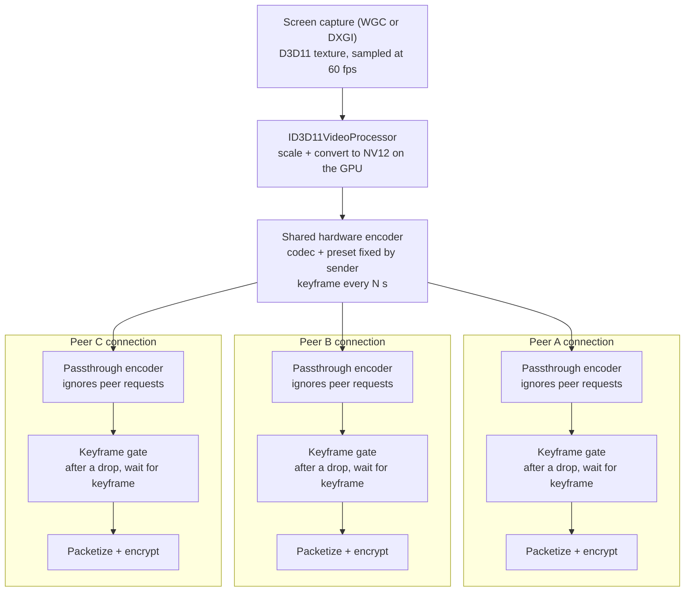

# Hardware video encoding and encode-once for Voice on Windows

## Goal

Windows Voice calls encode video on the GPU instead of the CPU. Mesh calls then
encode each shared track once and send that same stream to every peer, instead
of running one encoder per peer connection. The sender chooses the codec:
H.264 (default), H.265 or AV1.

The target is high-resolution gameplay: capture a 7680×2160 240 Hz desktop,
scale it on the GPU and send it as 3840×1080 at 60 fps to several peers, from
one NVENC session. The reference sender is an RTX 5090 (hardware AV1) with
300 Mbps of upload.

The audience is friends sharing gameplay. Simple, reliable code matters more
than smooth playback for every peer, so the design makes deliberate
concessions:

| Topic | Decision |
| --- | --- |
| Order | Hardware encoder first, then encode-once |
| Codec | Sender picks H.264 (default), H.265 or AV1; only codecs the sender's GPU encodes in hardware are offered |
| Bitrate, resolution, frame rate | Fixed by a sender preset (e.g. 720p60, 1080p60, half of the source at 60 fps); peers never lower it |
| Keyframes | Fixed interval chosen by the sender; keyframe requests from peers are ignored |
| Slow or late peers | Freeze or wait until the next keyframe (up to ~5 s is acceptable) |
| Peer that can't decode the codec | Gets no video, with a message saying why; no fallback encoder |
| Per-peer adaptation | None: no temporal layers, no per-peer thinning, no pausing |
| Sender upload too small | The user's responsibility; the picker shows how much upload the preset needs |

## Where we stand

Both goals mean building libwebrtc ourselves. None of this is a Dart-only
change.

| Area | Today | Where |
| --- | --- | --- |
| Windows app | No top-level `windows/` runner and no Windows CI job. The vendored `flutter_webrtc` already has Windows plugin code. | repository root, `.github/workflows` |
| libwebrtc | Prebuilt `libwebrtc.m150.7871.03` from webrtc-sdk. The Linux copy has software encoders only: VP8, OpenH264, AV1 (libaom), VP9. | `packages/discourse_voice/third_party/flutter_webrtc/third_party/libwebrtc_version.ini` |
| Decoders (desktop) | ffmpeg H.264, libvpx, dav1d AV1, all in software. No H.265 decoder: the Linux binary has only the H.265 parser. | same prebuilt binary |
| Decoders (Apple) | webrtc-sdk's VideoToolbox decoders for H.264 and H.265 in hardware; dav1d for AV1 | Darwin `flutter_webrtc` |
| Encoder hooks | The C++ wrapper can't take a custom encoder factory. Its only encoded-frame hook is the frame cryptor. | `third_party/libwebrtc/include/rtc_peerconnection_factory.h` |
| Mesh sending | One connection and one video sender per peer, so N peers means N encodes. Camera and screen share use the same video sender. Video has no codec preference or bitrate limit; only audio has one (`_applyAudioQuality`). | `MeshVoiceMediaSession._createPeerNow` in `lib/src/plugins/voice/voice_media.dart` |
| SFU | The LiveKit transport already exists, with screen share up to 1080p30. Through an SFU the client already encodes once. | `LiveKitVoiceMediaSession` in `voice_media.dart` |

Flutter itself offers nothing here: it has no codec API, and its video plugins
play files and URLs through the platform player. WebRTC video is encoded and
decoded inside libwebrtc, so only the codecs built into our libwebrtc count.

## Reference clients

Litecord is the one to study. Serein encodes once only because it sends a
single stream to Discord's server.

| | [Serein](https://github.com/ViceVerse-cz/Serein) | [Litecord](https://github.com/Ak4ai/Litecord) |
| --- | --- | --- |
| Stack | Rust, own RTP stack | Rust, own peer-to-peer protocol plus str0m for browser viewers |
| Windows encoder | Media Foundation hardware H.264 (picks NVENC, AMF or QSV) | NVENC direct via `nvEncodeAPI64.dll`, QSV via Media Foundation, AMF (untested), OpenH264 fallback |
| Capture to encoder | Windows.Graphics.Capture, CPU readback and CPU conversion to NV12 | DXGI or WGC, the D3D11 video processor converts to NV12, textures go straight to NVENC (zero-copy) |
| Encode once | No: one upstream to Discord's server | Yes: one encoded frame sent to every viewer |
| Per-peer policy | Discord's server adapts per viewer | One keyframe and one bitrate for everyone (set by the worst viewer), no simulcast |
| Licence | MIT / Apache-2.0 | MIT; avoid its bundled FFmpeg DLLs (no licence notice) |

LiveKit's Rust SDK has the cleanest libwebrtc-side prior art for encode-once:
a passthrough encoder plus a frame buffer that carries already-encoded frames.
Its NVENC code is Linux-only.

## Constraints

- **NVENC session limit.** GeForce cards allow 8 concurrent encode sessions
  per system (fewer on older drivers and low-end cards). With one encoder per
  peer, camera plus screen share hits it at about 4–5 peers. Encode-once
  removes the problem.
- **Codec support.**

  | Codec | Hardware encode | Who can watch |
  | --- | --- | --- |
  | H.264 | Every GPU | Everyone, including browsers |
  | H.265 | Every gaming GPU in use (NVIDIA since Pascal; AMD and Intel equivalents) | Apple peers in hardware; Windows and Linux peers once Phase 2 adds ffmpeg's HEVC decoder; not Firefox |
  | AV1 | RTX 40, RX 7000, Intel Arc and newer | Every peer running our app (dav1d); most browsers |

  AV1 on older iPhones decodes in software. Test 1080p60 there before
  recommending AV1 widely. Media Foundation H.265 decoding can require
  Microsoft's paid HEVC Video Extensions on some Windows machines, so desktop
  H.265 decoding uses ffmpeg in software.
- **Upload.** In mesh the sender uploads one copy per peer. Typical rates for
  fast-moving gameplay at 3840×1080, 60 fps (estimates, not measurements):

  | Codec | Bitrate | Upload to 3 peers | Upload to 6 peers |
  | --- | --- | --- | --- |
  | H.264 | ~25 Mbps | ~75 Mbps | ~150 Mbps |
  | H.265 | ~15 Mbps | ~45 Mbps | ~90 Mbps |
  | AV1 | ~12 Mbps | ~36 Mbps | ~72 Mbps |

  300 Mbps of upload covers every row, so the reference sender can spend more
  bitrate per peer than these figures. Peers' download is the limit instead.
- **H.264 level.** 3840×1080 at 60 fps needs High profile at level 5.1 or 5.2
  (`profile-level-id` `640033` or `640034`); the default negotiated profile
  stops around 720p. H.265 and AV1 need the matching level too.
- **Licensing.**
  - NVENC: write our own wrapper against the MIT-licensed `nvEncodeAPI.h` or
    FFmpeg's `nv-codec-headers`, and load the driver DLL at runtime. NVIDIA's
    `NvEncoder*.cpp` samples are under NVIDIA's EULA; don't copy them.
  - AMD AMF and Intel oneVPL are MIT. Media Foundation is an OS API.
  - H.264 and H.265 patent royalties need counsel review. Cisco's OpenH264
    coverage doesn't apply to a statically built OpenH264.

## Phase 0 — Windows build

Needed whatever else we choose. Done when a mesh call with screen share works
on Windows with software encoding, and we have CPU and frame-rate numbers at
1080p, 1440p and the 7680×2160 source as a baseline.

- [ ] Add the Windows Flutter runner and build Voice with the stock libwebrtc.
- [ ] Add a Windows CI job (format, analyze, build).
- [ ] Cover the Windows plugin files in `tool/vendor_provenance_contract.dart`.
- [ ] Record the software-encoding baseline.

## Phase 1 — Check the shipped DLL (about a day)

Find out what the prebuilt Windows `libwebrtc.dll` already offers before
forking anything.

- [ ] List the sender video codecs on Windows.
- [ ] Check for webrtc-sdk's Media Foundation H.265 encoder
  (`src/win/wmf_h265_encoder.cc`). Its release script appears to enable it,
  but the binary is unverified.
- [ ] If present, run a Windows-to-Windows test call with H.265 preferred, to
  measure what hardware encoding buys.

## Phase 2 — Our own libwebrtc with hardware encoders

Done when Windows senders encode on the GPU, fall back to software cleanly,
and diagnostics show which encoder ran.

1. Fork `webrtc-sdk/libwebrtc` on `m150_release`. Build `libwebrtc.dll` (x64,
   arm64) in CI, point `libwebrtc_version.ini` at our release, and document
   the fork in `PATCHES.md`.
2. Add a Windows `HardwareVideoEncoderFactory`:
   - Media Foundation first, adapted from `wmf_h265_encoder.cc`, for H.264,
     H.265 and AV1: hardware encoders only, low latency, CBR, no B-frames.
   - Direct NVENC later, behind a capability check, for better latency
     tuning.
   - Wrap it in libwebrtc's software-fallback wrapper so a failed session
     drops to a software encoder for that sender only.
3. Add ffmpeg's HEVC decoder to the Windows and Linux builds, so desktop peers
   can watch H.265.
4. Plumb the choice to Dart: a factory option through `flutter_webrtc`, a
   Voice setting (Auto / Hardware / Software), and the `encoderImplementation`
   stat in Voice diagnostics through `voice_diagnostics_report.dart`.

## Phase 3 — Encode once, send to many

One hardware encoder per shared track feeds every mesh peer; each peer
connection only packetizes and encrypts. Captured frames stay on the GPU
from capture to encoder.

Done when:

- a 7680×2160 240 Hz source is sent as 3840×1080 at 60 fps AV1 to 3 peers,
  using one NVENC session and no CPU frame copies on the sender;
- the same works with H.264 and H.265;
- a peer that drops frames freezes and recovers at the next keyframe without
  affecting the others.

Keyframe and bandwidth requests from peers never reach the encoder; nothing a
peer does changes the shared stream.

### Parts (C++ in our libwebrtc fork)

1. **GPU capture and scaling.** At 7680×2160 a captured frame is about 66 MB.
   At 60 fps the current CPU path would copy and convert about 4 GB/s, so
   frames must stay on the GPU:
   - Capture with WGC or DXGI and keep the `ID3D11Texture2D` in a native
     `VideoFrameBuffer`. Sample at the preset's frame rate, not the display's
     240 Hz.
   - Scale and convert to NV12 in one `ID3D11VideoProcessor` pass, as Litecord
     does. NVENC doesn't scale its input. Halving 7680×2160 to 3840×1080 keeps
     the 32:9 aspect ratio.
   - Hand the texture to NVENC as DirectX input, or to Media Foundation
     through `IMFDXGIDeviceManager`.
   - Keep CPU conversion only as a fallback, for local preview and software
     encoders.
2. **Shared encoder.** Owns the hardware session. Its settings come only from
   the sender: codec, resolution, frame rate, CBR bitrate and a fixed keyframe
   interval.
3. **Passthrough encoder per peer**, modelled on LiveKit's
   `passthrough_video_encoder.cpp`. Forwards the shared encoded frames,
   ignores requested rate changes and keyframe requests, and reports no
   scaling and trusted rate control so libwebrtc doesn't resize anything. It
   fills in the codec-specific frame information libwebrtc needs to packetize:
   simple for H.264 and H.265, more involved for AV1, whose packets need a
   frame-dependency header on every frame (LiveKit has done this).
4. **Per-peer keyframe gate.** The only per-peer logic, and it can't be
   skipped. If libwebrtc drops a frame for one peer, that peer gets nothing
   until the next keyframe. Otherwise its next frame would point at the wrong
   reference and decode corrupted instead of freezing.
5. **Factory wiring and a "shared encode" track flag** exposed through
   `flutter_webrtc`.

### Required libwebrtc settings

The passthrough sends at the preset's fixed bitrate. If that exceeds what
libwebrtc allows for a peer, libwebrtc drops frames for that peer, and the
keyframe gate turns each drop into a freeze until the next keyframe. These
settings are therefore part of the design, not tuning:

- Set the sender's maximum bitrate (`encodings[].maxBitrate`) to the preset's
  rate. Without it libwebrtc caps video at roughly 2.5 Mbps.
- Raise the bandwidth estimate's start and minimum bitrates to the preset's
  rate. The estimate otherwise starts at a few hundred kbps, and the peer
  freezes repeatedly while it climbs.
- Negotiate a codec level that covers the preset (see Constraints).
- Pin all three in tests.

### Dart side (`MeshVoiceMediaSession`)

- Set the flag on the screen-share track.
- Set the chosen codec as the sender's codec preference, and keep resolution
  fixed under congestion.
- Add a picker for codec and preset. Offer only codecs the GPU encodes in
  hardware, include presets that halve the source resolution, and show the
  upload it needs ("needs ~X Mbps upload with N viewers").
- Lay out 32:9 video tiles without shrinking them into a letterbox.
- Tell a peer that can't decode the chosen codec why it has no video.

### Rules

| Decision | Who decides |
| --- | --- |
| Codec | Sender |
| Bitrate, resolution, frame rate | Sender preset, fixed |
| Keyframes | Sender, fixed interval |
| Lost packets | libwebrtc's built-in per-peer retransmission (NACK/RTX); no code from us |
| Peer that can't keep up | Freezes until the next keyframe |
| Peer that joins late | First picture at the next keyframe |
| Peer that can't decode the codec | No video, with a message |

We don't build temporal layers, per-peer frame-rate thinning, keyframe rate
limits, keyframes on join, an automatic upload check, pausing slow peers, or a
fallback encoder.

### Tests

- C++ unit tests for the gate (drop, gate, resume on keyframe) and the
  passthrough (rate and keyframe requests ignored), for each codec.
- Dart tests in the style of the existing Voice session tests, pinning the
  sender parameters and codec preference.

## Phase 4 — Receivers, if measurements demand it

Measure receivers at the 3840×1080, 60 fps target before building anything
here.

- **Decoding.** A 3840×1080 60 fps H.264 stream is heavy for ffmpeg's
  software decoder; dav1d copes better with AV1 on desktop. If software
  decoding can't keep up, add hardware decoders in the same fork (Media
  Foundation on Windows, VA-API or NVDEC on Linux).
- **Drawing.** `flutter_webrtc` converts each decoded frame to RGBA on the CPU
  and copies it into a Flutter texture: about 1 GB/s at this size. If that
  costs too much, pair hardware decoding with a GPU texture path into Flutter.

## Open questions

- [ ] Is Windows a committed target? Phase 0 also means installer, signing and
  update work.
- [ ] Are we OK owning a libwebrtc build (Windows x64 and arm64, possibly
  Linux) on every upstream bump?
- [ ] Which presets and keyframe interval ship by default (e.g. 720p60 /
  1080p60, 2–5 s)?
- [ ] Do browser peers on the Discourse web client join mesh calls, and which
  browsers must watch H.265 and AV1 streams?
- [ ] With Windows HDR on, captured frames need converting to SDR. Can the
  same `ID3D11VideoProcessor` pass do it acceptably, or do we need a tone-map
  shader?
- [ ] Does Linux get hardware encoding later (NVENC or VA-API)? LiveKit's
  Linux code is the reference.
- [ ] Counsel review of H.264 and H.265 royalties.

## Sources

- [Serein](https://github.com/ViceVerse-cz/Serein):
  `crates/discord-voice/src/video_encode_windows.rs`, `transport.rs`
- [Litecord](https://github.com/Ak4ai/Litecord): `encoder/nvenc_d3d11.rs`,
  `gpu_tx.rs`, `manager.rs`, `web_share.rs`
- [webrtc-sdk/libwebrtc](https://github.com/webrtc-sdk/libwebrtc):
  `src/win/wmf_h265_encoder.cc`, `build/libwebrtc_win_build.cmd`
- [LiveKit rust-sdks webrtc-sys](https://github.com/livekit/rust-sdks/tree/main/webrtc-sys/src):
  `passthrough_video_encoder.cpp`, `encoded_video_frame_buffer.cpp`, `nvidia/`
- [NVENC application note](https://docs.nvidia.com/video-technologies/video-codec-sdk/12.2/nvenc-application-note/index.html)
  (session limits)
- [FFmpeg nv-codec-headers](https://github.com/FFmpeg/nv-codec-headers)
